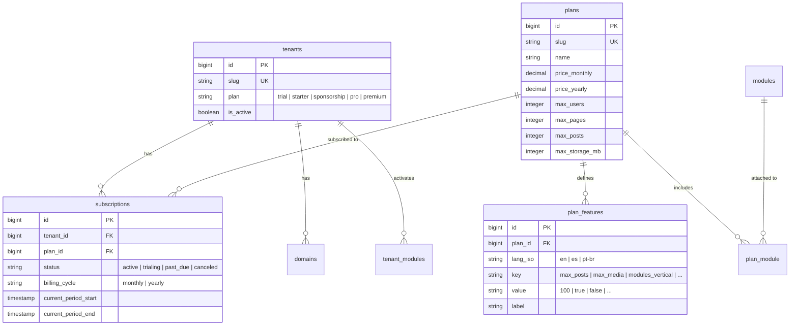
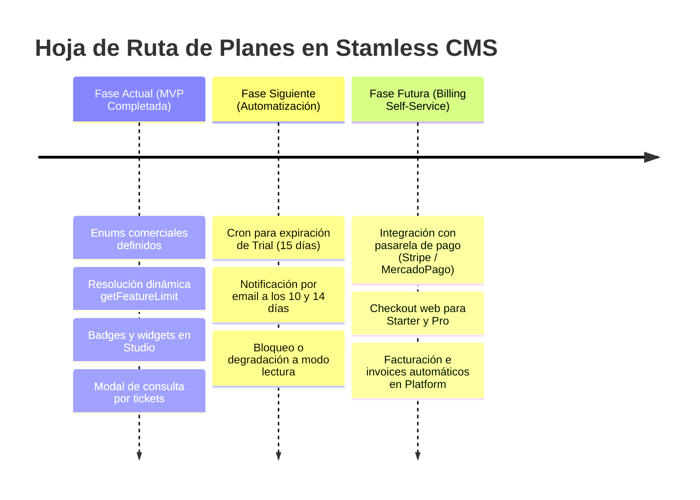

# Stamless CMS Headless — Estructura y Gobernanza de Planes

> **Documento de Contexto y Transferencia Técnica para Agentes de IA y Desarrolladores.**  
> Fuente de verdad sobre la escala comercial, esquema de base de datos, enums, resolución dinámica de límites, experiencia en Studio y roadmap de implementación.

---

## 1. Visión y Escala Comercial de Planes

Stamless CMS Headless adopta una escala comercial clara, transparente y escalonada de 5 planes, diseñada para freelancers, estudiantes, convenios institucionales y agencias:

| Plan | Slug (`key`) | Tarifa | Orientación y Propósito | Límites Destacados | Marca / Copyright |
| :--- | :--- | :--- | :--- | :--- | :--- |
| **Trial** | `trial` *(legacy: `free`, `freemium`)* | $0 (15 días) | Onboarding y pruebas. Sin tarjeta de crédito. | 10 posts, 10 páginas, 5 servicios, 250 MB | Estándar fijo ("Powered by Stamless") |
| **Starter** | `starter` *(legacy: `freelance`)* | $7 / mes<br>($70 / año) | Estudiantes, practicantes, freelancers y proyectos iniciales. | 50 posts activos, 30 páginas, 15 servicios, 1 GB | Copyright 100% editable sin marca |
| **Convenio / Auspicio** | `sponsorship` | $0 B2B | Convenios institucionales o acuerdos de patrocinio (ej. CICA360 Cliente 0). | 100 posts activos, 50 páginas, 25 servicios, 2 GB | Acotado: `©2026 [Cliente] - Todos los derechos reservados <br> Powered by Stamless` |
| **Pro** | `pro` | $20 / mes<br>($200 / año) | Negocios establecidos, agencias y sitios de alta producción. Módulos verticales habilitados. | 250 posts, 150 páginas, 50 servicios, 5 GB | Marca y Studio 100% personalizables |
| **Premium** | `premium` *(legacy: `corporate`)* | Desde $99 / mes<br>($990 / año) | Grandes cuentas, corporaciones o sitios con alta volumetría de tráfico y contenido. | 1.000 posts, 1.000 páginas, 150 servicios, 20 GB | Marca blanca total y soporte dedicado |

---

## 2. Arquitectura de Datos y Modelado

La gestión de planes utiliza un modelo híbrido resiliente: compatibilidad directa por string en `Tenant` combinada con un catálogo relacional normalizado (`plans` + `plan_features` + `subscriptions`).



### Tabla `tenants`
- Columna `plan` (string indexado): Guarda el slug activo. Valores oficiales: `trial`, `starter`, `sponsorship`, `pro`, `premium`.
- Aliases históricos resueltos en tiempo de ejecución:
  - `'free'`, `'freemium'` $\rightarrow$ resuelto como `trial` vía `PlanEnum::tryFromKey()`.
  - `'freelance'` $\rightarrow$ resuelto como `starter`.
  - `'corporate'` $\rightarrow$ resuelto como `premium`.

### Tabla `plans`
- Definida en [`database/seeders/PlanSeeder.php`](file:///Users/edu/Storage/webapps/projects/stamless/database/seeders/PlanSeeder.php) y migrada en `2026_08_13_000011_create_plans_table.php`.
- Contiene precio, moneda, orden de presentación y capacidades generales.

### Tabla `plan_features`
- Catálogo clave-valor para cuotas específicas (`max_posts`, `max_services`, `max_testimonials`, `max_sliders`, `max_media`, `max_menus`, `max_menu_items`, `max_api_tokens`, `max_users`, `custom_copyright`, `modules_vertical`).
- Soporta i18n mediante la columna `lang_iso` (`App\Enums\LanguageEnum`).

---

## 3. Lógica de Negocio y Enums en PHP

### `App\Enums\PlanEnum`
Ubicación: [`app/Enums/PlanEnum.php`](file:///Users/edu/Storage/webapps/projects/stamless/app/Enums/PlanEnum.php)  
Enum respaldado (Backed Enum `string`) que implementa `HasLabel`, `HasColor` de Filament:

```php
enum PlanEnum: string implements HasLabel, HasColor
{
    case Trial = 'trial';
    case Starter = 'starter';
    case Sponsorship = 'sponsorship';
    case Pro = 'pro';
    case Premium = 'premium';
}
```

#### Métodos clave de `PlanEnum`:
1. `tryFromKey(?string $key): ?self`: Resuelve de forma tolerante slugs legacy (`free` $\rightarrow$ `Trial`, `freelance` $\rightarrow$ `Starter`, `corporate` $\rightarrow$ `Premium`).
2. `getLabel(): string`: Nombre visible traducido (`__('Trial')`, `__('Starter')`, `__('Sponsorship')`, etc.).
3. `getBadgeLabel(): string`: Etiqueta del badge (`__('15-day Trial')`, `__('Starter Active')`, `__('B2B Agreement')`, `__('Pro Active')`, `__('Top Tier')`).
4. `getColor(): string`: Color Filament (`warning` para Trial, `info` para Starter, `gray` para Convenio, `success` para Pro, `primary` para Premium).
5. `getActionButtonLabel(): ?string`:
   - `Trial`: `__('Upgrade plan')` $\rightarrow$ "Mejorar plan"
   - `Starter`: `__('Upgrade to Pro')` $\rightarrow$ "Subir a Pro"
   - `Sponsorship`: `__('Request expansion')` $\rightarrow$ "Consultar ampliación" *(tono no comercial)*
   - `Pro`: `__('Upgrade to Premium')` $\rightarrow$ "Subir a Premium"
   - `Premium`: `null` *(tope de gama)*
6. `canUpgrade(): bool`: `false` únicamente para `Premium`.
7. `isFreeTier(): bool`: `true` para `Trial` y `Sponsorship`.
8. `canEditCopyright(): bool`: `false` para `Trial`; `true` para `Starter`, `Pro`, `Premium`; acotado para `Sponsorship`.

---

## 4. Motor de Resolución Dinámica de Límites (`Tenant.php`)

Para evitar divergencias entre los contadores de la UI y los seeders, [`app/Models/Tenant.php`](file:///Users/edu/Storage/webapps/projects/stamless/app/Models/Tenant.php) implementa `getFeatureLimit()`:

```php
public function getFeatureLimit(string $featureKey, ?int $default = null): ?int
{
    // 1. Intenta resolver desde la base de datos (plan_features) si existe el Plan
    $plan = $this->planModel() ?? Plan::where('slug', $this->plan)->first();

    if ($plan) {
        $featureValue = PlanFeature::where('plan_id', $plan->id)
            ->where('key', $featureKey)
            ->value('value');

        if ($featureValue !== null && is_numeric($featureValue)) {
            return (int) $featureValue;
        }
    }

    // 2. Fallback a la escala canónica en PlanEnum
    $planEnum = $this->planEnum();
    ...
}
```

### Tabla Comparativa de Límites por Recurso:

| Método en `Tenant` | Clave `plan_features` | Trial | Starter | Sponsorship (Convenio) | Pro | Premium |
| :--- | :--- | :---: | :---: | :---: | :---: | :---: |
| `maxPosts()` | `max_posts` | 10 | 50 | **100** | 250 | 1.000 |
| `maxContentsPerType()` | `max_pages` *(desglosado)* | 5 Pág / 3 Leg / 2 Foot | 20 Pág / 5 Leg / 5 Foot | **30 Pág / 10 Leg / 10 Foot** | 100 Pág / 25 Leg / 25 Foot | 800 Pág / 100 Leg / 100 Foot |
| *(Total Contenidos)* | — | 10 | 30 | **50** | 150 | 1.000 |
| `maxServices()` | `max_services` | 5 | 15 | **25** | 50 | 150 |
| `maxTestimonials()` | `max_testimonials` | 3 | 15 | **25** | 50 | 150 |
| `maxSliders()` | `max_sliders` | 1 | 3 | **5** | 15 | 50 |
| `maxMedia()` | `max_media` | 20 | 100 | **150** | 500 | 2.000 |
| `maxMenus()` | `max_menus` | 3 | 5 | **5** | 10 | 30 |
| `maxMenuItems()` | `max_menu_items` | 5 | 10 | **15** | 30 | 50 |
| `maxApiTokens()` | `max_api_tokens` | 5 | 5 | **10** | 25 | 100 |
| `maxUsers()` | `max_users` | 1 | 2 | **3** | 10 | 50 |
| Almacenamiento (MB) | `max_storage_mb` | 250 MB | 1.024 MB (1 GB) | **2.048 MB (2 GB)** | 5.120 MB (5 GB) | 20.480 MB (20 GB) |

> **Nota sobre Contactos (`ContactResource`):**  
> El badge de contactos (`0/0`) **no tiene límite de plan**. Muestra `contactos_pendientes / contactos_totales` para seguimiento de leads comerciales.

---

## 5. Experiencia de Usuario en Filament Studio

### 1. `PlanStatusWidget` (Dashboard)
Ubicación: [`app/Filament/Widgets/PlanStatusWidget.php`](file:///Users/edu/Storage/webapps/projects/stamless/app/Filament/Widgets/PlanStatusWidget.php)
- Se renderiza en la primera fila junto a `WelcomeWidget`.
- Presenta el nombre del plan, el badge descriptivo y una explicación honesta sin promesas engañosas.
- Acción interactiva `consultAction()`:
  - Botón contextual corto según el plan (`Mejorar plan`, `Subir a Pro`, `Consultar ampliación`, `Subir a Premium`).
  - Abre un modal centrado compacto (`modalWidth('lg')`) para enviar directamente un ticket de soporte clasificado como `SupportTicketCategoryEnum::PlanUpgrade` con origen `widget_plan`.

### 2. `PlanUsageWidget` (Dashboard)
Ubicación: [`app/Filament/Widgets/PlanUsageWidget.php`](file:///Users/edu/Storage/webapps/projects/stamless/app/Filament/Widgets/PlanUsageWidget.php)
- Muestra barras de progreso horizontales comparando el recuento real de filas del tenant contra su tope dinámico (`$tenant->maxPosts()`, etc.).
- Umbral de alertas de color:
  - Menor a 80%: gris / neutro.
  - Entre 80% y 99%: advertencia (ámbar / naranja).
  - 100% o más: peligro (rojo).

### 3. Badges del Menú Lateral (Sidebar Navigation)
Implementados con el trait `App\Filament\Concerns\FormatsUsageBadge`:
- Cada recurso (`PostResource`, `ServiceResource`, `PageResource`, etc.) calcula su badge como `actual/límite`.
- Se actualizan en tiempo real al crear, editar o eliminar registros.
- Bloqueo preventivo: Cuando se alcanza el límite, el botón "Crear" se deshabilita con un tooltip explicativo y se valida en el hook `->before()` de la acción server-side.

---

## 6. Internacionalización (i18n)

1. **Inglés como idioma neutral:**  
   Todas las definiciones en código y llamadas a `__('...')` deben residir en inglés:
   - `__('Trial')`, `__('Starter')`, `__('Sponsorship')`, `__('Pro')`, `__('Premium')`
   - `__('Upgrade plan')`, `__('Upgrade to Pro')`, `__('Request expansion')`, `__('Upgrade to Premium')`
2. **Diccionarios sincronizados:**
   - [`lang/en.json`](file:///Users/edu/Storage/webapps/projects/stamless/lang/en.json)
   - [`lang/es.json`](file:///Users/edu/Storage/webapps/projects/stamless/lang/es.json)
   - [`lang/pt-br.json`](file:///Users/edu/Storage/webapps/projects/stamless/lang/pt-br.json)
3. **Comando de escaneo obligatorio:**  
   Tras modificar o agregar nuevas cadenas en código o vistas Blade:
   ```bash
   php artisan translator:update
   ```
   *Siempre revisar y completar cualquier clave vacía generada.*

---

## 7. Plan de Implementación y Roadmap Futuro



### Reglas para nuevos agentes:
- **No reintroducir el término `free`:** Usar `PlanEnum::Trial` o `trial`.
- **No hardcodear números de límites en controladores ni recursos:** Consultar siempre a través de `$tenant->maxX()` o `$tenant->getFeatureLimit('key')`.
- **Para convenios B2B (`sponsorship`):** No tratarlo como un plan comercial agresivo; el copy debe mantenerse como `"Consultar ampliación"` y canal de atención institucional.
